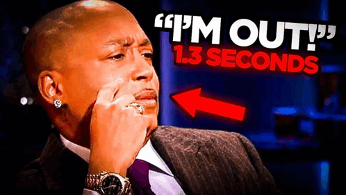

I decided to take a chance on a random book I found on Amazon—no reviews, self-published, mystery. Part of me wanted to see if I could find a diamond in the rough, while the other part of me was curios of what makes a good novel good, and what makes one bad—what does a bad novel look like? This novel was certainly the latter. 

The book actually started off quite well. The first chapter introducing the detectives was solid. There was some wit and charm to the writing. 

Early on the the detectives (Angel Treadwell and Dulles A Calamari) were talking 

> “…that would not be an environmentally friendly action.”

”Environmentally friendly? It’s only the first page we’re talking about. And don’t we recycle the paper anyway?”

 “But if more people took care not to waster paper, even a sinfle sheet, the recyclers wouldn’t have to spend so much for their machines and electricity to run them.”

Dulles looked hard at his partner. “I didn’t take you for a tree-hugger, Angel.”

”The world would be a better place if we all were.”

”Hold your arms out wide,” Dulles requested.

’What?”

”Just do it.”

Angel hesitated but then held her arms out to the side. 

Calamari studied the pose and nodded. “Just as I thought. It looks like you can hug enough trees for both of us, so I’m off the hook.”
> 

This was fun, witty, and charming to me. 
There was also another line towards the end of the chapter—Angel has been on the phone, getting information about a new case. When she gets off Calamarie tries to continue the conversation they left off. 

> He looked up “Ah, whaat about the dinner idea?”
”Didn’t you just hear me on the phone?”
”No, I make it a habit of eavesdropping on other people’s phone conversations.”
> 

There was a *Monk*  like charm to this that I appreciated. I thought I was in for a fund read. Little did I know it would go completely downhill from here.

Everything about this story just felt so off and weird. The names, the plot, the dialogue. Oh my days, the dialogue was absolutely horrendous. 
One scene in particular stands out, where someone has been stalking Angel. She calls Calamarie and he comes to her house, he arrives and a revolver is placed in his back. 

> A raspy voice whispered. “Well, well, Calamari, just as I figured, stalking your partner would eventually bring you to me.”
> 

A few moments later.

> “You don’t remember me, Calamari? I’m devastated. I’m Bernie Upper. You must remember me. It was before you took on this beauty as a partner.”

”Oh yes I remember. You torched your home with all of your family in it.”

”That’s me. I would have gotten away with it, too, if I hadn’t stayed behind to watch them crying out helplessly from the upstairs window.”
> 

I mean goodness gracious, you talk a bout bad writing. Mind you this scene ends with Bernie going into depth about how he escaped prison and waited years to pull this off to get his hands on Calamari, and the scene ends with Angel shooting him in hid face. 

This connects back to the main plot in no way, shape, or form. 

This book was a tremendous waste of time and it’s best purpose served was making me feel extremely grateful for the actual good novels that I choose to read.
